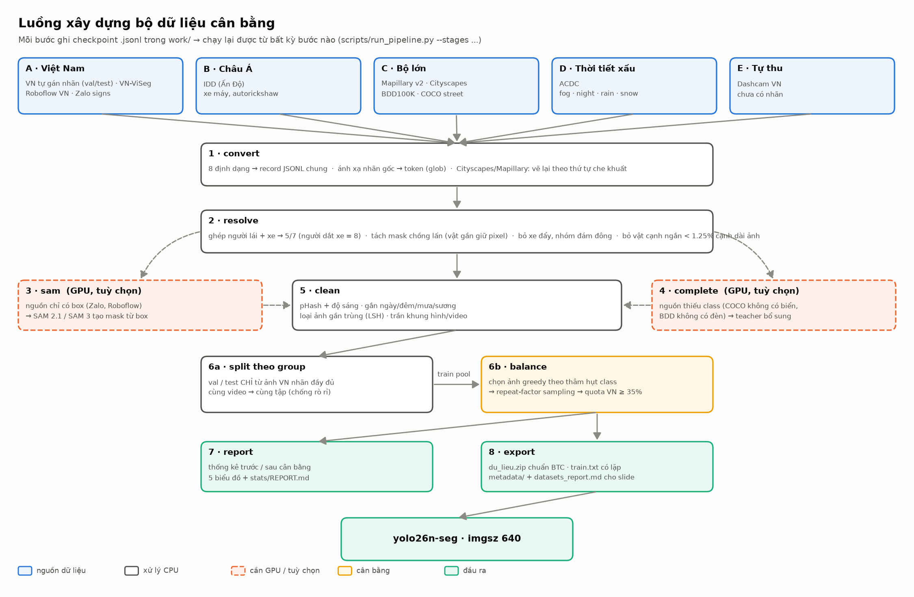
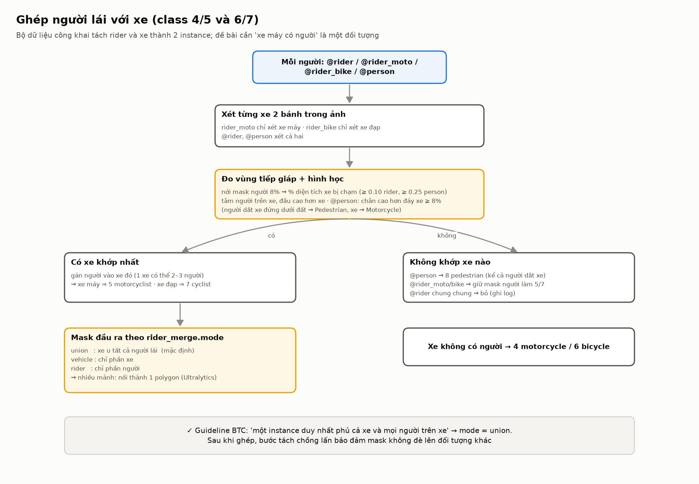
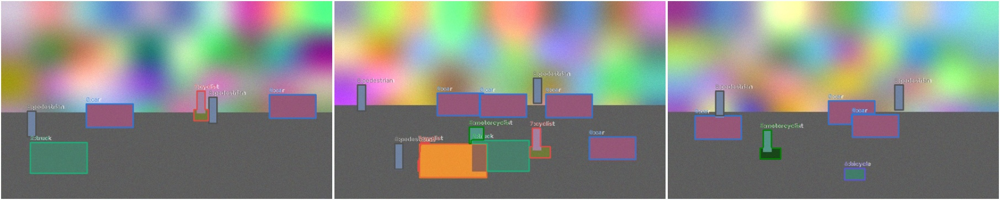
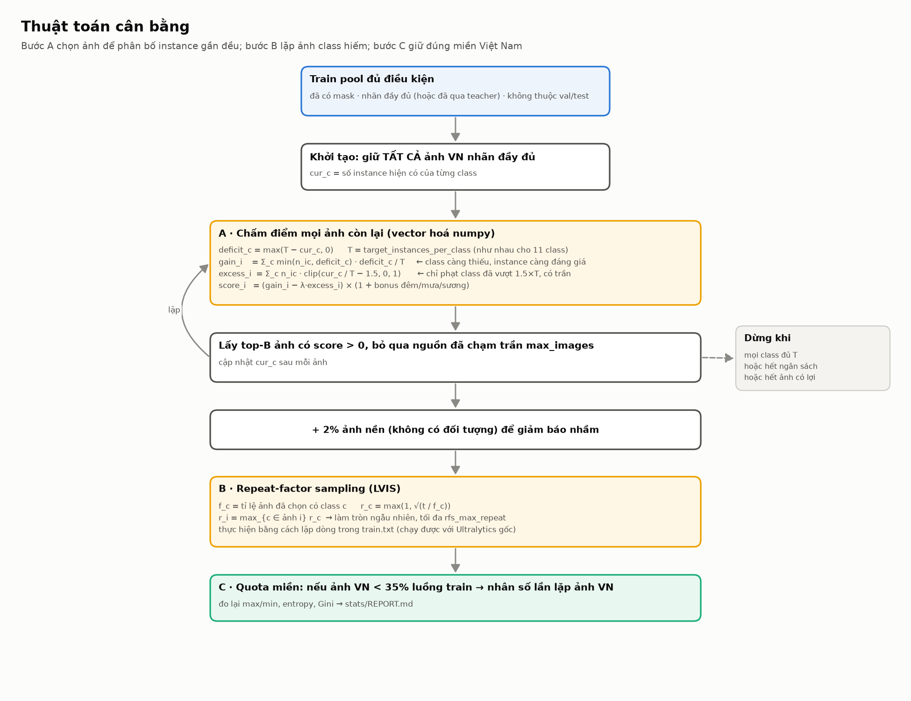

# Team 10 · Seed 15 · VN Traffic Balanced v2: bộ dữ liệu instance segmentation giao thông cho 11 lớp RoboTaxi

Đây là pipeline dữ liệu và luồng huấn luyện **bản chốt (v2)** của Đội 10 (seed 15) cho cuộc thi
**AIInAction RoboTaxi Data-Centric**. Pipeline làm các việc sau:

* Gom 10 bộ dữ liệu công khai và chuẩn hoá về **11 lớp theo guideline gán nhãn của BTC**.
* Dùng **teacher 11 lớp** để bù lớp bị thiếu nhãn và thay nhãn người/xe hai bánh kém chất lượng của các bộ VN.
* Ghép người lái với xe, tách mask chồng lấn, bỏ vật mà bộ chấm không tính.
* Loại ảnh trùng, cân bằng lớp, rồi xuất **`du_lieu_v2.zip` đúng cấu trúc BTC**.

Mỗi ảnh có metadata nguồn gốc đầy đủ. Bảng bộ dữ liệu cho slide được sinh tự động.

> Model và kích thước ảnh cố định (`yolo26n-seg`, 640), nên thứ duy nhất ta cải thiện được là dữ liệu.
> Điểm hiển thị trên trang thi = **100 × √(mask mAP@50)**, trung bình đều 11 lớp. Vì vậy lớp hiếm nặng ngang lớp phổ biến.

**Kết quả:** v2 đạt **60.30** điểm public (mask mAP@50 = 36.36), cao nhất trong các phương án đã thử (mục 9).



---

## Mục lục
1. [11 lớp & quy ước BTC](#1-11-lớp--quy-ước-btc)
2. [Luồng chuẩn (v2)](#2-luồng-chuẩn-v2)
3. [Nguồn dữ liệu đã dùng](#3-nguồn-dữ-liệu-đã-dùng)
4. [Ánh xạ lớp, SAM & teacher](#4-ánh-xạ-lớp-sam--teacher)
5. [Ghép người lái, tách chồng lấn, lọc vật nhỏ](#5-ghép-người-lái-tách-chồng-lấn-lọc-vật-nhỏ)
6. [Làm sạch, chia tập, cân bằng](#6-làm-sạch-chia-tập-cân-bằng)
7. [Thống kê bộ dữ liệu cuối](#7-thống-kê-bộ-dữ-liệu-cuối)
8. [Model, huấn luyện & đóng gói bài nộp](#8-model-huấn-luyện--đóng-gói-bài-nộp)
9. [Kết quả & các phương án đã loại](#9-kết-quả--các-phương-án-đã-loại)
10. [Chạy lại từ đầu](#10-chạy-lại-từ-đầu)
11. [Đầu ra & metadata](#11-đầu-ra--metadata)
12. [Cấu trúc thư mục](#12-cấu-trúc-thư-mục)
13. [Hạn chế đã biết](#13-hạn-chế-đã-biết)
14. [Tài liệu tham khảo](#14-tài-liệu-tham-khảo)

---

## 1. 11 lớp & quy ước BTC

| ID | Lớp | Định nghĩa BTC (tóm tắt) | Pipeline xử lý |
|---:|---|---|---|
| 0 | car | Sedan, SUV, minivan, **bán tải**, taxi, **xe 9–15 chỗ** | |
| 1 | bus | Xe buýt, xe khách **từ 16 chỗ** | |
| 2 | truck | Xe tải, xe ben, xe bồn, cứu hoả, **chỉ phần đầu kéo** | |
| 3 | other_vehicle | Ba gác, xích lô, xe lam, xe công trình, **rơ-moóc / container**, tàu điện… | `train`, `trailer`, `caravan`, autorickshaw → 3 |
| 4 | motorcycle | Xe máy **không người** | |
| 5 | motorcyclist | **Một instance phủ cả xe và mọi người trên xe** | ghép `union` (mục 5) |
| 6 | bicycle | Xe đạp không người | |
| 7 | cyclist | Một instance phủ cả xe đạp và người | ghép `union` |
| 8 | pedestrian | Người không ngồi trên phương tiện, **kể cả người dắt xe** | `@person` thành rider khi chân cao hơn đáy xe |
| 9 | sign | **Chỉ mặt biển**, không gán cột, không gán biển quảng cáo | bỏ mặt sau biển (`@ignore`) |
| 10 | traffic_light | **Cả hộp đèn** | |

Các quy ước chung của BTC mà pipeline thực thi:

* Mask chỉ phủ **phần nhìn thấy** và **không chồng nhau**.
* Các vật sau **không gán**:
  * người sau kính, người trong ô tô;
  * xe đẩy tay, động vật;
  * vật có cạnh ngắn < 1.25% cạnh dài ảnh.

Cấu hình: [configs/classes_v2.yaml](data/configs/classes_v2.yaml).

## 2. Luồng chuẩn (v2)

`scripts/run_pipeline.py` chạy các bước theo đúng thứ tự dưới đây. Tham số lấy từ
[configs/pipeline_v2.yaml](data/configs/pipeline_v2.yaml).

| # | Bước | Việc làm | Tham số chính |
|---:|---|---|---|
| 1 | tải | Bản sao Hugging Face, Roboflow (CC BY), Drive của đội → `raw/` | `scripts/download_hf*.py`, `download.py` |
| 2 | `convert` | Đọc polygon JSON / COCO / YOLO-seg / YOLO-detect, ánh xạ nhãn gốc sang 11 lớp | `label_map` từng nguồn trong [sources_v2.yaml](data/configs/sources_v2.yaml) |
| 3 | `sam` | Nguồn chỉ có box: SAM vẽ mask từ box người gán | `sam_model: sam2.1_b.pt` |
| 4 | `complete` | **Teacher 11 lớp** (checkpoint v1 epoch 2) bù lớp nguồn không gán. Trên nguồn VN, teacher thay có chọn lọc nhãn người/xe hai bánh | `teacher_class_conf` sign / light / other 0.4, các lớp khác 0.5; `teacher_replace` |
| 5 | `resolve` | Ghép người lái + xe, tách chồng lấn xa → gần, bỏ vật nhỏ | `min_short_side_frac 0.0125`, `min_area_640 64` |
| 6 | `clean` | Loại ảnh gần trùng, giới hạn khung hình/video, gắn ngày/đêm, chia val/test theo group | pHash Hamming ≤ 4, ≤ 400 khung/group, val 15% / test 5% |
| 7 | `balance` | Chọn ảnh greedy theo thâm hụt, giữ mọi ảnh VN, repeat-factor sampling | T = 20 000 inst/lớp, ≥ 35% ảnh VN, RFS ngưỡng 0.3, lặp tối đa 4 |
| 8 | `report` | Thống kê trước / sau cân bằng, biểu đồ | `stats/REPORT.md` |
| 9 | `export` | Ảnh 640 px JPEG 92, nhãn YOLO-seg, metadata → `du_lieu_v2.zip` | `export.*` |
| 10 | train | Notebook BTC, danh sách train đã lặp RFS, 35 epoch | [train/train.py](train/train.py) |
| 11 | nộp | Xuất ONNX fp32 bằng bước 4 của notebook BTC, kiểm tra cấu trúc, đóng gói zip | [train/export_submission.py](train/export_submission.py) |

Trang HTML [reports/raw_overview.html](data/reports/raw_overview.html) trình bày cùng luồng này. Trang gồm:
* tổng quan dữ liệu thô;
* các bước xử lý, với số liệu lấy từ cấu hình;
* số ảnh / instance của bộ cuối;
* độ phủ 11 lớp, ma trận nguồn × lớp;
* cảnh báo;
* thẻ từng nguồn có ảnh mẫu.

Bản phân tích cũ của v1 được giữ ở `reports/raw_overview_v1.html`.

## 3. Nguồn dữ liệu đã dùng

Số liệu dưới đây lấy từ bộ v2 cuối (`dataset_v2/metadata/datasets_report.md`, tự sinh). **Bảng này dùng cho slide.**

| Bộ dữ liệu | Link | License | Ảnh train | Dòng train (sau RFS) | Val | Test | Nguồn nhãn |
|---|---|---|---:|---:|---:|---:|---|
| India Driving Dataset (IDD) Segmentation | [inai.iiit.ac.in](https://inai.iiit.ac.in/domains/idd.html) | IDD license (phi thương mại) | 4,174 | 4,816 | 772 | 459 | người gán |
| Mapillary Vistas v2.0 | [mapillary.com/dataset/vistas](https://www.mapillary.com/dataset/vistas) | CC BY-NC-SA 4.0 | 1,446 + 185 | 1,847 + 238 | 811 + 115 | 273 + 29 | người gán |
| Cityscapes (gtFine) | [cityscapes-dataset.com](https://www.cityscapes-dataset.com/) | Cityscapes (phi thương mại) | 1,274 | 1,822 | 468 | 0 | người gán |
| nuImages v1.0 (tập con có lớp hiếm) | [nuscenes.org/nuimages](https://www.nuscenes.org/nuimages) | CC BY-NC-SA 4.0 | 6,065 | 7,295 | 0 | 0 | người gán + teacher bù biển/đèn |
| MS COCO 2017 (cảnh phố, 11 lớp) | [cocodataset.org](https://cocodataset.org/) | CC BY 4.0 (nhãn) | 2,299 | 2,906 | 0 | 0 | người gán + teacher bù biển |
| Vietnam Traffic Sign (HF thanhhiepvos) | [huggingface.co](https://huggingface.co/datasets/thanhhiepvos/vietnam_traffic_sign) | CC BY-SA 3.0 | 2,406 | 4,996 | 0 | 0 | SAM từ box + teacher |
| Roboflow vn_traffic v2 (projectxla) | [universe.roboflow.com](https://universe.roboflow.com/projectxla/vn_traffic/dataset/2) | CC BY 4.0 | 2,722 | 5,754 | 0 | 0 | SAM từ box + teacher |
| Roboflow Traffic_VN v1 | [universe.roboflow.com](https://universe.roboflow.com/thiens-workspace-mryll/traffic_vn-2sdka/dataset/1) | CC BY 4.0 | 26 | 52 | 0 | 0 | SAM từ box |
| Tuk Tuk & Rickshaw Detection (HF) | [huggingface.co](https://huggingface.co/datasets/shravya11/tuk-tuk-detection) | CC BY 4.0 | 641 | 698 | 0 | 0 | SAM từ box + teacher |
| **Tổng** | | | **21,238** | **30,424** | **2,166** | **761** | |

Ở dòng Mapillary, số đầu là phần có panoptic, số sau (`+`) là phần chỉ có polygon (752 ảnh gốc).
Ánh xạ chi tiết từng nhãn gốc sang lớp đích, kèm số instance thực tế, nằm trong `datasets_report.md`.

Các nguồn đã thử nhưng **không dùng ở v2**:
* BDD100K: thiếu biển và đèn.
* ACDC: ảnh xấu trời châu Âu, trùng vai trò với nguồn khác.
* Roboflow vietnam_vehicles: cần đăng nhập.
* VN-ViSeg, Zalo 2020: không tải kịp.

## 4. Ánh xạ lớp, SAM & teacher

**Ánh xạ** được khai báo theo từng nguồn trong `label_map`. Pipeline khớp tên chính xác trước, rồi mới đến glob `*`:

```yaml
"object--traffic-sign--*back*": "@ignore"   # mặt sau biển báo
"object--traffic-sign--*": sign
"object--vehicle--wheeled-slow": "@ignore"   # xe đẩy tay: BTC không gán
"human--rider--motorcyclist": "@rider_moto"  # người lái -> ghép với xe máy
person: "@person"                            # chưa biết đi bộ hay đang lái
pedestrian: "@person"                        # COCO 11 lớp của đội gán người lái là pedestrian -> xét lại
```

**SAM** (`sam`): với nguồn chỉ có box (biển báo VN, Roboflow, tuk-tuk), SAM 2.1 vẽ mask bên trong box do người gán.

**Teacher** (`complete`, `teacher_mode: v2`): dùng checkpoint 11 lớp của v1 (epoch 2) làm teacher. Teacher làm hai việc:

1. **Bù lớp thiếu.** Nguồn không gán một lớp nào đó sẽ được teacher thêm instance của lớp đó. Ví dụ: COCO và nuImages
   thiếu biển báo, bộ biển báo VN thiếu xe. Ngưỡng là 0.4 cho sign / traffic_light / other_vehicle và 0.5 cho các
   lớp khác. Instance nào chồng với nhãn người gán thì bị bỏ.
2. **Thay có chọn lọc** (`teacher_replace`). Trên các nguồn VN, nhãn `@person`, pedestrian và xe hai bánh trong bộ
   gốc (box của mô hình COCO) bị bỏ, và teacher gán lại chính các lớp đó. **Nhãn biển báo của người gán được giữ
   nguyên.** Chúng tôi từng thử thay toàn bộ nhãn, nhưng cách đó làm mất khoảng 31k nhãn tốt nên đã bỏ.

Ở cột `label_origin` trong metadata: `human`, `merged`, `sam_box`, `teacher` (kèm `conf`).

## 5. Ghép người lái, tách chồng lấn, lọc vật nhỏ



* **Ghép rider** (`rider_merge.mode: union`): người lái và xe máy/xe đạp được gộp thành **một** polygon lớp 5/7. Xe
  không người giữ lớp 4/6. `@person` chỉ thành người lái khi chân cao hơn đáy xe; người dắt xe là pedestrian.
* **Tách chồng lấn** (`deoverlap`): vẽ lại các vật theo thứ tự xa → gần. Vật có đáy thấp hơn trong ảnh được coi là gần
  camera hơn; biển và đèn vẽ cuối cùng. Vật ở trước giữ pixel chồng lấn, nên mask chỉ còn phần nhìn thấy.
* **Lọc vật nhỏ**: bỏ vật có cạnh ngắn của bbox < 1.25% cạnh dài ảnh (ngưỡng BTC không gán). Thêm vào đó, bỏ vật có
  **diện tích < 64 px² ở 640**, vì bộ chấm BTC bỏ qua GT nhỏ như vậy. Train trên những vật này chỉ dạy model dự đoán
  vật không được tính điểm.



## 6. Làm sạch, chia tập, cân bằng

| Bước | Cách làm |
|---|---|
| Loại ảnh gần trùng | pHash 64-bit + LSH 4 band + union-find, Hamming ≤ 4. Khi trùng, giữ ảnh của nguồn có `priority` cao hơn |
| Trần theo video | Tối đa 400 khung hình mỗi `group`, lấy mẫu đều |
| Chia tập | Theo **group**: khung hình cùng video luôn nằm cùng một tập. Đội chưa có ảnh VN gán tay, nên val/test lấy từ các nguồn có nhãn người gán đủ 11 lớp (IDD, Mapillary, Cityscapes): val 15%, test 5% |
| Cân bằng | Chọn ảnh greedy theo thâm hụt: mỗi instance của lớp *c* được tính điểm `deficit_c / T`, với T = 20 000. Lớp vượt 1.5 × T bị phạt nhẹ, có trần. Giữ toàn bộ ảnh VN; luồng train phải có ≥ 35% ảnh VN |
| Repeat-factor sampling | Theo cách của LVIS: `r_i = max_c √(t / f_c)`, với t = 0.3, lặp tối đa 4 lần, thực hiện bằng cách lặp dòng trong `train.txt` |
| Giới hạn nguồn lớn | nuImages ≤ 6 000 ảnh, COCO ≤ 2 500, Cityscapes ≤ 3 000, để giữ tỉ lệ ảnh VN và thời gian mỗi epoch |



## 7. Thống kê bộ dữ liệu cuối

Nguồn: `dataset_v2/stats/REPORT.md`.

| Giai đoạn | Ảnh | Instance | Max/min | Entropy ↑ | Gini ↓ |
|---|---:|---:|---:|---:|---:|
| Thô (sau chuyển đổi) | 47,701 | 685,590 | | | |
| Pool sạch (trước cân bằng) | 45,300 | 394,750 | 36.0 | 0.824 | 0.479 |
| Đã chọn (chưa lặp) | 21,238 | 206,451 | 16.7 | 0.908 | 0.355 |
| **Train hiệu dụng (sau RFS)** | **30,424** | **285,414** | **12.7** | **0.906** | **0.371** |
| Val | 2,166 | 26,114 | | | |
| Test | 761 | 8,989 | | | |

| Lớp | Trước cân bằng | % | Sau (hiệu dụng) | % |
|---|---:|---:|---:|---:|
| 0 Ô tô con | 144,593 | 36.6 | 72,036 | 25.2 |
| 1 Xe buýt / xe khách | 14,701 | 3.7 | 11,593 | 4.1 |
| 2 Xe tải | 28,435 | 7.2 | 20,550 | 7.2 |
| 3 Phương tiện khác | 19,200 | 4.9 | 14,825 | 5.2 |
| 4 Xe máy (không người) | 17,721 | 4.5 | 15,802 | 5.5 |
| 5 Xe máy (có người) | 26,274 | 6.7 | 30,533 | 10.7 |
| 6 Xe đạp (không người) | 12,866 | 3.3 | 12,396 | 4.3 |
| 7 Xe đạp (có người) | 4,013 | 1.0 | 5,681 | 2.0 |
| 8 Người đi bộ | 71,622 | 18.1 | 46,005 | 16.1 |
| 9 Biển báo | 38,289 | 9.7 | 37,895 | 13.3 |
| 10 Đèn giao thông | 17,036 | 4.3 | 18,098 | 6.3 |

Tỉ lệ ảnh VN trong luồng train tăng từ 11.4% lên **35.5%**. Biểu đồ nằm trong `dataset_v2/stats/*.png`.

## 8. Model, huấn luyện & đóng gói bài nộp

### 8.1 Model đã train trên bộ v2

| Mục | Giá trị |
|---|---|
| Kiến trúc | **YOLO26n-seg** (Ultralytics 8.4.214), BTC cố định, không được sửa kiến trúc |
| Quy mô | 310 lớp, **3,088,261 tham số**, **10.4 GFLOPs** ở 640 |
| Khởi tạo | `yolo26n-seg.pt` pretrain COCO (notebook BTC), đầu ra 11 lớp |
| Dữ liệu | `du_lieu_v2.zip`: 21,238 ảnh train (30,424 dòng sau RFS), val 2,166, test 761 |
| Phần cứng | 1 × NVIDIA RTX A6000 48 GB (Thunder Compute), PyTorch 2.15 + CUDA 13.2 |
| Thời gian | 35 epoch theo lịch. Từ epoch 23, chạy tiếp (`--resume`) trên máy thứ hai nhanh hơn, mỗi epoch ~14–17 phút |
| Checkpoint đã nộp | `runs/v2t/weights/last.pt` ở epoch 28 → `models/v2t_ep28/submission.zip` |
| Bài nộp (ONNX) | fp32, opset 17, input `[1,3,640,640]`, output `[1,47,8400]` + proto `[1,32,160,160]`; `model.onnx` 10.6 MB, zip 9.7 MB |
| Kiểm tra BTC | Đạt: chữ ký kiến trúc yolo26n-seg, nc = 11, có tên lớp trong metadata |
| Hậu xử lý khi chấm (BTC) | conf 0.001, IoU NMS 0.7, max_det 100, multi-label; GT < 64 px² ở 640 bị bỏ qua |

mask mAP trên val v2 theo epoch (đo bằng bộ validator Ultralytics với cùng hậu xử lý):

| Epoch | 1 | 12 | 22 | 25 | 26 (tắt mosaic) | 28 | 29 |
|---|---:|---:|---:|---:|---:|---:|---:|
| mask mAP@50 | 0.393 | 0.465 | 0.508 | 0.512 | 0.516 | **0.519** | 0.519 |
| mask mAP@50-95 | 0.209 | 0.257 | 0.283 | 0.286 | 0.288 | **0.290** | 0.290 |

### 8.2 Huấn luyện

[train/train.py](train/train.py) chạy **thư viện trong notebook BTC nguyên vẹn**. Chỉ bước 3 được tuỳ biến: nạp
`train.txt` đã lặp RFS và các tham số augment.

| Tham số | Giá trị | Lý do |
|---|---|---|
| model / imgsz / seed | `yolo26n-seg`, 640, 15 | BTC cố định |
| epochs / batch | 35 / 32 | Vừa thời gian trên 1 GPU A6000 |
| lịch | optimizer auto (MuSGD, lr 0.01), `cos_lr`, warmup 3, `lrf` 0.01 | |
| `close_mosaic` | 10 | 10 epoch cuối train trên ảnh thật, không ghép mosaic; điểm tăng rõ từ epoch 26 |
| augment | mosaic 1.0, copy_paste 0.3, mixup 0, scale 0.5, fliplr 0.5, HSV mặc định, không xoay / cắt xiên | Giữ hình học đường phố, mép mask sắc |

### 8.3 Chọn checkpoint & đóng gói

Chọn checkpoint: theo **mask mAP@50 trên val v2**. Trên val này, thứ hạng các model khớp với thứ hạng public
(v1k 0.519 > v3t 0.511, tương ứng 58.46 > 57.04).

```powershell
python train/train.py --version v2t --data <thư mục giải nén du_lieu_v2.zip> --epochs 35 --batch 32 --workers 6
```

```powershell
python train/export_submission.py --weights runs/v2t/weights/last.pt --out submissions/v2t
```

`export_submission.py` chạy bước 4 của notebook BTC: xuất ONNX fp32 với input [1,3,640,640], kiểm tra chữ ký kiến trúc
và tên lớp, rồi đóng gói `submission.zip` (một file `model.onnx`, ~9.7 MB).

## 9. Kết quả & các phương án đã loại

| Phương án | Dữ liệu | Public | mask mAP@50 public | Ghi chú |
|---|---|---:|---:|---|
| v1, epoch 2 | v1: nguồn công khai + VN (SAM), chưa có teacher 11 lớp | 53.03 | 28.1 | mốc đầu tiên |
| v1k, 40 epoch (Kaggle) | v1 | 58.46 | 34.18 | |
| v3t, 25 epoch | **chỉ nhãn người** (IDD/Cityscapes/Mapillary) + 3.6k ảnh **copy-paste có ngữ cảnh** | 57.04 | 32.53 | xe máy/xe đạp không người tăng, nhưng mất ảnh VN nên bus/truck/cyclist giảm |
| Trộn trọng số v1k + v3t (hoặc + v2t) | | (val 0.503 ở 50/50) | | thấp hơn cả hai model gốc; đã loại |
| **v2t, epoch 28** | **v2** | **60.30** | **36.36** | **bản chốt** |

AP@50 từng lớp trên public của v2t (epoch 28):

| Lớp | v1k | v3t | v2t | Chênh v2t so với v1k |
|---|---:|---:|---:|---:|
| Ô tô con | 52.4 | 51.9 | 52.2 | −0.3 |
| Xe buýt / xe khách | 41.1 | 34.1 | **52.6** | **+11.5** |
| Xe tải | 41.1 | 36.6 | 40.0 | −1.1 |
| Phương tiện khác | 8.1 | 8.5 | **12.6** | +4.5 |
| Xe máy (không người) | 25.6 | 30.8 | 29.5 | +3.9 |
| Xe máy (có người) | 48.4 | 46.7 | 49.5 | +1.1 |
| Xe đạp (không người) | 12.4 | 21.7 | **24.7** | **+12.3** |
| Xe đạp (có người) | 55.7 | 45.6 | 54.0 | −1.7 |
| Người đi bộ | 36.4 | 33.5 | 34.7 | −1.7 |
| Biển báo | 16.2 | 13.7 | 15.5 | −0.7 |
| Đèn giao thông | 38.6 | 34.9 | 34.7 | −3.9 |

Bài học rút ra:
* **Ảnh VN là phần không thể thiếu.** Bỏ ảnh VN (v3) làm giảm mạnh bus, truck và cyclist.
* **Teacher 11 lớp cộng thay nhãn có chọn lọc** giúp nhiều nhất ở bus, other_vehicle và bicycle.
* **Train đủ lịch rồi mới chọn checkpoint.** Ở cả v1 và v2, điểm tăng ở các epoch cuối khi lr thấp và mosaic đã tắt.
* **Biển báo vẫn yếu (~15)** ở mọi phương án, kể cả khi dán thêm biển lên cột. Đây là khác biệt giữa ảnh của ta và
  ảnh BTC chấm, không phải do thiếu số lượng.

## 10. Chạy lại từ đầu

Các lệnh pipeline chạy trong thư mục `data/`; lệnh train và đóng gói chạy ở gốc repo.

```powershell
pip install -r requirements.txt
```

1. Tải nguồn. `hf auth login` giúp tránh giới hạn lượt gọi API.
   ```powershell
   python scripts/download_hf.py mapillary cityscapes vn_signs
   ```
   ```powershell
   python scripts/download.py --list
   ```
   IDD, nuImages, COCO 11 lớp và Roboflow: xem `download` trong [configs/sources_v2.yaml](data/configs/sources_v2.yaml).
   nuImages lấy tập con có lớp hiếm bằng `scripts/nuimages_select.py`.
2. Xem dữ liệu thô và luồng xử lý (chỉ đọc):
   ```powershell
   python scripts/analyze_raw.py --config configs/pipeline_v2.yaml
   ```
3. Chạy từng nguồn: `convert`, rồi `sam` và `complete` cho nguồn cần (bước này cần GPU và `models/teacher_v1.pt`):
   ```powershell
   python scripts/run_pipeline.py --config configs/pipeline_v2.yaml --stages convert,sam,complete --sources vn_traffic_sign_hf,roboflow_vn_traffic_v2i,roboflow_traffic_vn,tuk_tuk_rickshaw_hf,nuimages,coco2017_street_yoloseg
   ```
   ```powershell
   python scripts/run_pipeline.py --config configs/pipeline_v2.yaml --stages convert --sources idd_segmentation,mapillary_vistas_v2,mapillary_vistas_v2_poly,cityscapes
   ```
4. Chạy các bước chung cho mọi nguồn:
   ```powershell
   python scripts/run_pipeline.py --config configs/pipeline_v2.yaml --stages resolve,clean,balance,report,export
   ```
5. Kiểm tra bằng mắt:
   ```powershell
   python scripts/qa_grid.py --dataset dataset_v2 --sources vn_traffic_sign_hf,roboflow_vn_traffic_v2i --n 12 --out reports/qa_v2_vn.jpg
   ```
   ```powershell
   python scripts/diagnose_labels.py
   ```
6. Train và đóng gói như ở mục 8.

Chỉ muốn thử tham số cân bằng khác thì chạy lại `--stages balance,report,export`.

## 11. Đầu ra & metadata

```
dataset_v2/
├── data.yaml  train.txt (đã lặp RFS)  val.txt  test.txt
├── images/{train,val,test}/<source>__<id>.jpg      # cạnh dài 640
├── labels/{train,val,test}/<source>__<id>.txt      # YOLO-seg, 1 polygon / instance, không chồng nhau
├── stats/  REPORT.md  stats.json  *.png
└── metadata/
    ├── datasets_report.md          # ★ bảng cho slide: tên, link, license, số ảnh, ánh xạ 11 lớp
    ├── images.jsonl                # 1 dòng / ảnh: nguồn gốc, license, điều kiện, số lần lặp, nguồn nhãn
    ├── sources.json  class_mapping_observed.json  build_info.json  unselected_train_pool_uids.txt
du_lieu_v2.zip                      # cấu trúc BTC: images/, labels/, data.yaml, train/val/test.txt, metadata/, stats/
```

## 12. Cấu trúc thư mục

```
Team-10---Seed-15---Hackathon/
├── README.md                        # tài liệu này
data/
├── configs/
│   ├── classes_v2.yaml  sources_v2.yaml  pipeline_v2.yaml   # ★ bản chốt
│   ├── classes.yaml  sources.yaml  pipeline.yaml            # v1 (giữ để so sánh)
│   ├── *_v3.yaml                                            # v3 (sinh bởi scripts/v3_prepare.py)
│   └── *_demo.yaml                                          # dữ liệu tổng hợp để kiểm thử
├── vtb/
│   ├── common.py  converters.py     # schema, I/O, đọc mọi định dạng
│   ├── labeling.py                  # SAM box→mask, teacher bù lớp / thay có chọn lọc
│   ├── resolve.py                   # ghép rider, tách chồng lấn, lọc vật nhỏ
│   ├── quality.py                   # pHash, ngày/đêm, loại trùng, chia tập theo group
│   ├── balance.py  stats.py  export.py
│   └── rawstats.py  html_report.py  # trang HTML tổng quan + luồng
├── scripts/
│   ├── run_pipeline.py              # chạy toàn bộ / từng bước
│   ├── analyze_raw.py               # -> reports/raw_overview.html
│   ├── download*.py  nuimages_select.py  extract_frames.py
│   ├── qa_grid.py  visualize_labels.py  diagnose_labels.py
│   ├── copy_paste.py  v3_prepare.py # thí nghiệm v3 (không dùng cho bản chốt)
│   └── make_demo_data.py  simulate_balance.py  draw_diagrams.py
├── reports/                         # raw_overview.html, ảnh QA
└── docs/images/
train/
├── train.py                         # chạy notebook BTC, --resume, --init-weights, --set KEY=VALUE
└── export_submission.py             # .pt -> submission.zip (bước 4 notebook BTC)
```

## 13. Hạn chế đã biết

* **Val không phải ảnh VN.** Val lấy từ IDD/Mapillary/Cityscapes nên điểm tuyệt đối cao hơn test thật. Tuy vậy,
  thứ hạng giữa các model trên val khớp với public.
* **Nhãn teacher** (khoảng 28k instance trên các nguồn VN, COCO, nuImages) chưa được người duyệt hết.
* **Nhiễu so với guideline BTC:**
  * COCO/nuImages gán bán tải và xe 9–15 chỗ là truck/bus.
  * Xe container nguyên chiếc bị gán truck, trong khi BTC tách đầu kéo (truck) và rơ-moóc (other_vehicle).
* **Thứ tự độ sâu** khi tách chồng lấn dựa trên heuristic "đáy thấp hơn = gần hơn". Heuristic này sai với vật treo
  cao hoặc vật trên cầu vượt.
* **License:** phần lớn bộ ngoài là phi thương mại. Dùng được cho hackathon, không được phát hành lại.

## 14. Tài liệu tham khảo

* Trang cuộc thi và guideline gán nhãn: [competition.antco.ai](https://competition.antco.ai/)
* Varma et al., *IDD*, WACV 2019. Neuhold et al., *Mapillary Vistas*, ICCV 2017. Cordts et al., *Cityscapes*, CVPR 2016.
* Caesar et al., *nuScenes* / nuImages, CVPR 2020. Lin et al., *Microsoft COCO*, ECCV 2014.
* Gupta et al., *LVIS* (repeat-factor sampling), CVPR 2019.
* Ghiasi et al., *Simple Copy-Paste*, CVPR 2021 (thí nghiệm v3).
* Ravi et al., *SAM 2*, 2024. Ultralytics YOLO26.
